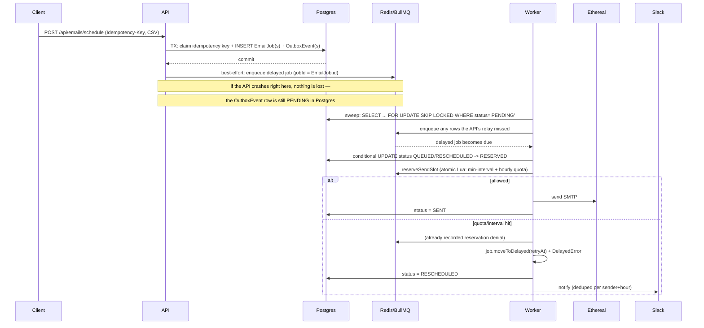

# ReachInbox Scheduler

A production-oriented email job scheduler: schedule large recipient lists to be
sent at a specific time, with real BullMQ/Redis delayed jobs (no cron),
per-sender rate limiting, Slack alerts on quota hits, Elasticsearch search, and
a React dashboard.

## Architecture

```mermaid
flowchart LR
  subgraph Client
    Web[React Dashboard]
  end

  subgraph API[apps/api]
    Auth[Google OAuth / Sessions]
    Sched[Scheduling API]
    SlackAPI[Slack OAuth]
    SearchAPI[Search API]
    BullBoard[Bull Board]
  end

  subgraph DB[(PostgreSQL)]
    Tables[(Tenants, Users, Campaigns,\nEmailJobs, OutboxEvent, ...)]
  end

  subgraph Worker[apps/worker]
    BullWorker[BullMQ Worker]
    RateLimiter[Redis Lua rate limiter]
    Mailer[Nodemailer -> Ethereal]
    SlackNotify[Slack notifier]
    Sweeps[Outbox / Index sweeps]
  end

  Redis[(Redis / BullMQ queue)]
  ES[(Elasticsearch)]
  Slack[Slack API]
  Ethereal[Ethereal SMTP]

  Web -->|cookies + fetch| API
  Sched -->|1. INSERT EmailJob + OutboxEvent\n(same transaction)| DB
  Sched -->|2. best-effort relay| Redis
  Sweeps -->|safety-net relay| DB
  Sweeps --> Redis
  BullWorker <--> Redis
  BullWorker --> RateLimiter --> Redis
  BullWorker --> DB
  BullWorker --> Mailer --> Ethereal
  BullWorker --> SlackNotify --> Slack
  Sweeps --> ES
  SearchAPI --> ES
  BullBoard --> Redis
```

### Scheduling & restart-safety sequence



## Project structure

```
apps/api/       Express API: auth, scheduling, idempotency, outbox producer,
                 Slack/Google OAuth, Elasticsearch search, Bull Board
apps/worker/    BullMQ consumer: rate limiting, Ethereal SMTP sending,
                 Slack notifications, outbox/index sweeps
apps/web/       React + Vite + Tailwind dashboard
packages/shared/ Shared TS types & zod schemas used by all three apps
infrastructure/ docker-compose.yml (Postgres, Redis, Elasticsearch)
```

## Prerequisites

- Node.js 20+, npm 10+
- Docker (for Postgres/Redis/Elasticsearch) — or run those three natively
- A Google Cloud OAuth client (Web application type)
- A Slack app (see below)

## Installation

```bash
npm install                       # installs all workspaces
cp .env.example .env               # fill in secrets (see below)
docker compose -f infrastructure/docker-compose.yml up -d
cd apps/api
npx prisma migrate dev             # creates tables
npx prisma generate                # generates the Prisma client
cd ../worker && npm run ethereal:create-account   # prints a fresh SMTP_USER/PASS
```

> **Elasticsearch on Linux**: bump `vm.max_map_count` before starting the
> container, or ES will fail its bootstrap check:
> `sudo sysctl -w vm.max_map_count=262144`

## Running

```bash
npm run dev:api      # Express API on :4000
npm run dev:worker   # BullMQ worker (separate process, as required)
npm run dev:web      # Vite dev server on :5173 (proxies /api, /admin to :4000)
```

Bull Board (protected by the same session auth as the rest of the API):
`http://localhost:4000/admin/queues`

## Environment configuration

See `.env.example` for the full list. Key ones:

| Variable | Purpose |
|---|---|
| `DATABASE_URL` | Postgres connection string |
| `REDIS_URL` | Redis connection string (BullMQ + rate limiter) |
| `TOKEN_ENCRYPTION_KEY` | AES-256-GCM key used to encrypt SMTP passwords & Slack tokens at rest — **must be identical** between `apps/api` and `apps/worker` |
| `WORKER_CONCURRENCY` | BullMQ worker concurrency (parallel sends) |
| `MIN_SEND_INTERVAL_MS` | Default minimum gap between sends for a sender (per-sender override lives on `SenderAccount`) |
| `MAX_EMAILS_PER_HOUR_PER_SENDER` | Default hourly quota (per-sender override lives on `SenderAccount`) |

### Google OAuth setup

1. Google Cloud Console → APIs & Services → Credentials → **Create OAuth client ID** → Web application.
2. Authorized redirect URI: `http://localhost:4000/api/auth/google/callback`.
3. Copy Client ID/Secret into `GOOGLE_CLIENT_ID` / `GOOGLE_CLIENT_SECRET`.

### Slack app setup

1. https://api.slack.com/apps → **Create New App** → From scratch.
2. **OAuth & Permissions** → Redirect URL: `http://localhost:4000/api/slack/oauth/callback`.
3. Bot Token Scopes: `chat:write`, `channels:read`, `groups:read`.
4. Copy Client ID/Secret/Signing Secret into `.env`.
5. In the dashboard: Settings → **Connect Slack** → pick a channel. You should
   immediately see a "ReachInbox is now connected to this channel ✅" message
   in that channel — that's the live verification call, not a log line.
6. To see a real rate-limit notification: create a sender with a low
   `maxEmailsPerHour` (e.g. 2), schedule 5+ emails for the same minute, and
   watch the channel.

### Ethereal SMTP

Ethereal (https://ethereal.email) is Nodemailer's fake-SMTP testing service —
messages are accepted and given a shareable preview URL, but **nothing is
delivered to a real inbox**. Run `npm run ethereal:create-account --workspace
apps/worker` to mint a fresh account, then create a `SenderAccount` (via
Settings → Add sender, or `POST /api/senders`) using those credentials. Going
to production means pointing a `SenderAccount` at a real SMTP provider —
nothing else in the code changes, since everything downstream only depends on
the standard SMTP transport contract.

## API examples

```bash
# Schedule emails (multipart: recipients file + form fields)
curl -X POST http://localhost:4000/api/emails/schedule \
  -H "Idempotency-Key: $(uuidgen)" \
  -b cookies.txt \
  -F senderAccountId=<id> \
  -F subject="Hello" \
  -F body="<p>Hi there</p>" \
  -F startTime=2026-10-01T09:00:00-07:00 \
  -F delayMs=2000 \
  -F hourlyLimit=200 \
  -F recipients=@leads.csv

curl -b cookies.txt "http://localhost:4000/api/emails/scheduled?page=1&pageSize=20"
curl -b cookies.txt "http://localhost:4000/api/search/emails?q=jane&status=SENT"
```

## Restart recovery — how it actually works

Every scheduling request commits the `EmailJob` row **and** an `OutboxEvent`
row in the same Postgres transaction. Only after that commit does the API
attempt to enqueue the BullMQ delayed job (`jobId` = the EmailJob's own id).
If the process is killed between the commit and that enqueue call, the
`OutboxEvent` is still sitting there with `status = 'PENDING'` — nothing was
lost, it just hasn't been relayed yet. The worker runs a lightweight
reconciliation sweep every 10s (`FOR UPDATE SKIP LOCKED`, so multiple
processes can run it concurrently without double-claiming rows) that finds
any such rows and relays them. **This sweep is not how emails are scheduled
to send** — that's 100% BullMQ's delayed-job timer, computed from
`EmailJob.scheduledFor` — the sweep only guarantees a row can never be
silently abandoned between the two systems.

On the worker side, a job is only ever moved out of `QUEUED`/`RESCHEDULED` via
a **conditional** `UPDATE ... WHERE status IN (...)`, so if two worker
processes somehow pick up the same stable `jobId` (e.g. after a stalled-job
recovery), only one of them wins the transition and actually calls SMTP.

**Known edge case (documented trade-off, not silently ignored):** if the
worker crashes *after* Ethereal accepts the message but *before* the
`status = SENT` update commits, a retry will resend that email — exactly-once
SMTP delivery isn't achievable without a two-phase commit with the SMTP
provider (which doesn't exist), so this system minimizes duplicates but
cannot fully eliminate this one narrow window. Similarly, the rate-limiter
reservation is consumed at the point of *attempting* a send, not confirmed
success — a crash between reservation and send costs one quota slot without
sending, which is the conservative direction to err in.

## Concurrency & rate limiting

A single Redis Lua script (`apps/worker/src/rateLimit/reserveSendSlot.ts`)
atomically enforces, per sender:

1. **Minimum interval** between sends (`sender.minSendIntervalMs`).
2. **Hourly quota** (`sender.maxEmailsPerHour`), keyed by the current
   clock-hour window.

Because both checks and the counter increment happen inside one Lua script,
there's no read-then-write race — this is correct across any number of
worker processes/instances, not just within one. This was verified in this
repo with a concurrency test (`reserveSendSlot.test.ts`): 50 simultaneous
reservations against a limit of 5 allow exactly 5 and reschedule the rest
with real future retry timestamps.

When a reservation is denied, the worker calls `job.moveToDelayed(retryAt)`
on the *same* BullMQ job (same `jobId`) rather than dropping it or creating a
new one — order is preserved as well as a single-queue FIFO can preserve it,
and since `retryAt` is always a real, strictly-later wall-clock time (next
interval tick, or the top of the next hour), this cannot loop forever.

## Failure handling & delivery guarantees

- **At-least-once delivery.** BullMQ retries (5 attempts, exponential
  backoff) handle transient SMTP errors; after the final attempt the job is
  marked `FAILED` in Postgres (visible in Sent Emails with failure details).
- **Idempotent scheduling.** The `Idempotency-Key` header is enforced via a
  Postgres unique constraint claimed *before* any campaign rows are created;
  a retried request with the same key+body replays the original response
  instead of creating duplicates.
- **Search is eventually consistent.** Postgres is the source of truth;
  Elasticsearch is kept in sync via its own outbox stream + sweep, so a slow
  or unavailable ES cluster can never block or lose an email — search results
  just lag briefly behind.

## Security

Helmet, scoped CORS (credentialed, single origin), signed+httpOnly session
cookies, Zod validation on every input, upload size limits, per-route rate
limiting (auth, scheduling), tenant-scoped queries everywhere (every Prisma
`where` includes `tenantId`; every ES query includes a `term: { tenantId }`
filter that is never derived from client input), AES-256-GCM encryption at
rest for SMTP passwords and Slack tokens, structured logging with request IDs
and secret redaction, centralized error handling, health/readiness endpoints,
graceful shutdown (SIGTERM/SIGINT drain the BullMQ worker and close DB/Redis
connections).

## Known limitations & trade-offs

- **`prisma generate` requires network access to `binaries.prisma.sh`** to
  fetch its query-engine binary. Run it once you have normal internet access;
  everything in this repo is written against the standard generated client.
- The transactional-outbox relay holds a short Postgres transaction open
  while calling Redis/Elasticsearch. Fine at this scale; at very high
  throughput you'd split "claim rows" and "call the external system" into
  separate steps.
- Campaign/aggregate endpoints (`GET /api/campaigns`) run one Prisma query
  per campaign for its status breakdown rather than a single set-returning
  query — simple and correct, not the most efficient at thousands of
  campaigns.
- Exactly-once SMTP delivery is fundamentally not guaranteed (see "Restart
  recovery" above) — documented rather than papered over.
- The `build` script's `tsc` output directory nesting across the shared
  package boundary is a known rough edge in this monorepo layout; `dev`
  (via `tsx`) is unaffected since it resolves TS sources directly.

## Testing

```bash
npm run test --workspace apps/api      # CSV parsing, idempotency hashing
npm run test --workspace apps/worker   # Redis rate-limiter concurrency (real Redis)
```

Both suites were actually executed during development, against a real local
Redis/Postgres — not just written and assumed to pass.

## 5-minute demo script

1. Sign in with Google.
2. Settings → add an Ethereal sender, connect Slack and pick a channel.
3. Compose → upload a CSV, set a low hourly limit (e.g. 3), schedule 6+ recipients for "now".
4. Scheduled Emails tab: watch statuses move PENDING → QUEUED → SENDING → SENT/RESCHEDULED.
5. Open an Ethereal preview link from Sent Emails.
6. Watch the Slack channel receive a rate-limit notification once the quota is hit.
7. Kill the worker process, restart it — remaining scheduled emails still send at their correct time, nothing duplicated.
8. Bull Board (`/admin/queues`) — show waiting/delayed/completed jobs live.
