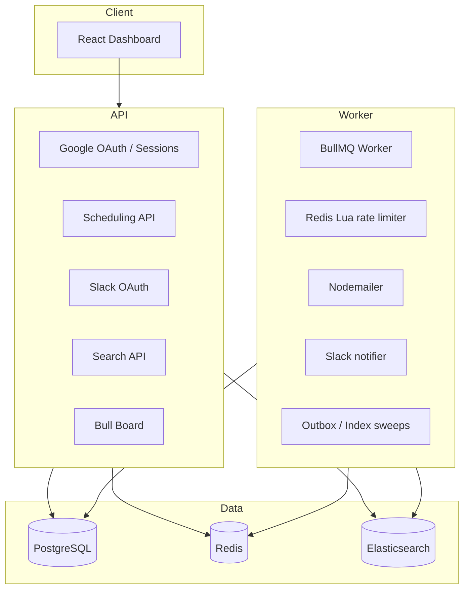
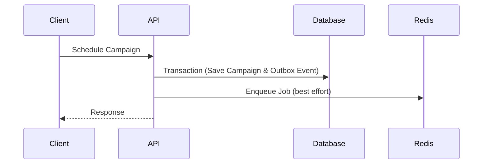
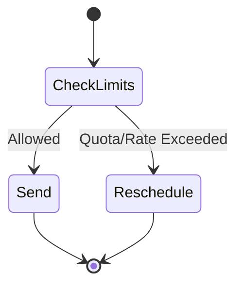
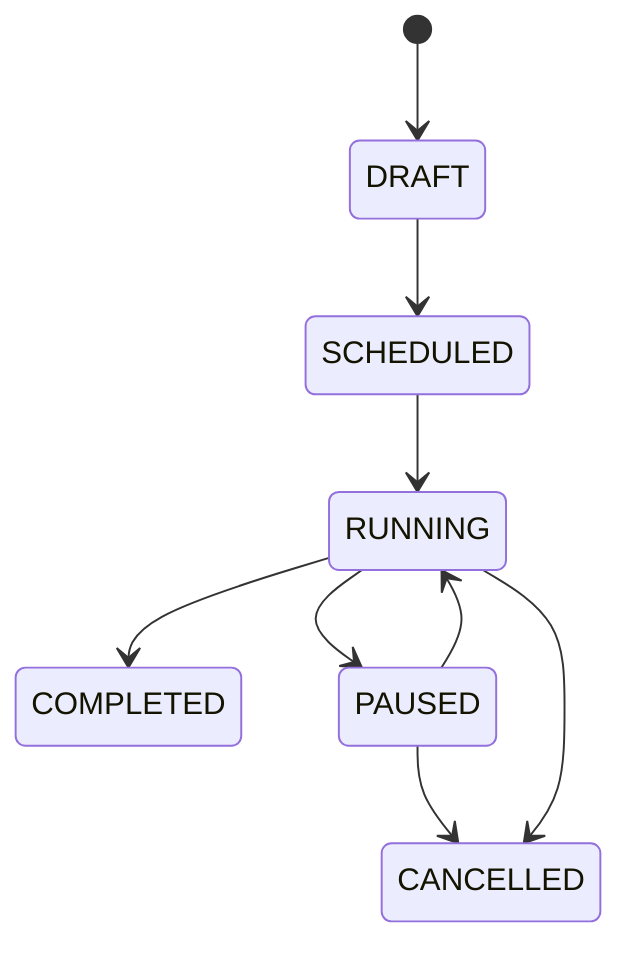
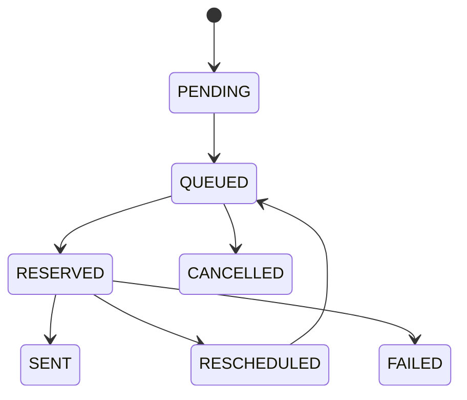

# Architecture

This document describes the high-level architecture of ReachInbox.

## System Architecture

## Request Flow Diagrams

## Transactional Outbox Pattern

To prevent dropped messages when the API goes down right after DB commit but before Redis enqueue, we use an Outbox pattern:
1. Insert OutboxEvent in the same transaction.
2. API does best-effort enqueue.
3. Background Sweeper in Worker finds pending OutboxEvents and ensures they are in Redis.

## Rate Limiting Flow

## Campaign Lifecycle State Machine

## Email Job State Machine

