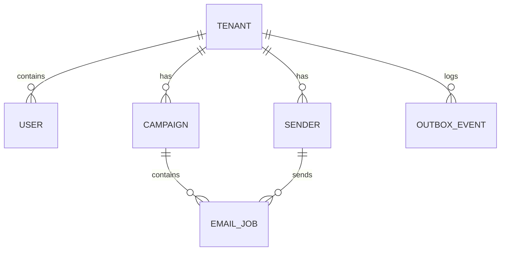

# Database Design

## ER Diagram

## Models

- **Tenant**: Top-level entity for B2B multi-tenancy.
- **User**: Represents a human logging into the system (Google Auth).
- **Sender**: Represents an email identity used to send out campaigns.
- **Campaign**: A collection of emails scheduled to be sent.
- **EmailJob**: An individual email to be sent at a specific time.
- **OutboxEvent**: Records pending events to push to queue/ES.

## Indexing Strategy
- Primary Keys: UUIDs
- Foreign Keys: Indexed for fast joins.
- Multi-tenancy: Every query MUST include `tenantId`. Indexes often start with `tenantId` to isolate tenant data lookups.

## Multi-tenancy Approach
Shared database, shared schema. All tables (except Tenant itself) include a `tenantId` column.

## Migration Strategy
Prisma migrations are used (`npx prisma migrate deploy`).
